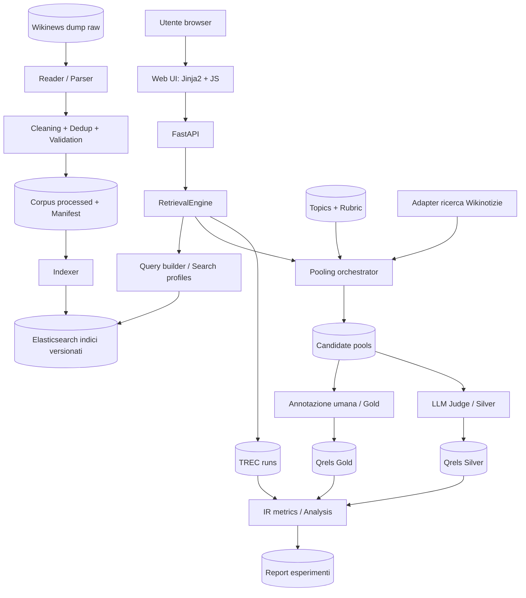

# Architettura tecnica — Wikinews Search Engine

**Versione documento:** 0.1.0 · **Data:** 2026-11-16 · **Stato:** blueprint preliminare approvato a livello tecnologico  
**Documenti correlati:** [PRD](./prd.md) · [Roadmap](./roadmap.md)

> **Nota sul nome:** questo file è denominato `architeture.md` per rispettare il nome richiesto. Un eventuale passaggio al più comune `architecture.md` dovrà aggiornare tutti i link interni al repository.

## 1. Obiettivi architetturali

Realizzare un sistema di Information Retrieval con quattro responsabilità isolate:

1. **Ingestion:** leggere il dump, normalizzare e validare le notizie, creare un corpus versionato.
2. **Retrieval:** indicizzare in Elasticsearch ed eseguire profili di ricerca configurabili.
3. **Web/API:** esporre il servizio di ricerca da browser e tramite HTTP.
4. **Evaluation:** costruire pooling, annotazioni e run; calcolare metriche senza dipendere dalla Web UI.

Si adotta un **monorepo modulare**: un solo codice Python, un servizio Elasticsearch, nessun database aggiuntivo per l'MVP. Non si introducono microservizi per moduli che possono convivere nello stesso processo/codice. Le elaborazioni di ingestione e valutazione vengono eseguite come job/CLI offline, non nelle normali richieste Web.

## 2. Stack e criteri di versione

| Livello | Scelta | Indicazioni |
|---|---|---|
| Runtime | Python 3.12 | Configurazione dichiarativa e tipi dove utili |
| Dependency manager | `uv`, `pyproject.toml`, `uv.lock` | Committare lockfile; installazioni ripetibili |
| Search | Elasticsearch 9.x | Bloccare una **patch specifica** in Docker e client Python compatibile |
| API | FastAPI, Pydantic | Contratti tipizzati e OpenAPI |
| Web | Jinja2, CSS, JavaScript essenziale | Nessuna build Node obbligatoria |
| Parsing | BeautifulSoup + lxml | Estrazione testo HTML con regole testate |
| Analisi | pandas | Audit, report, analisi errori |
| IR metrics | `ir-measures` | nDCG@10, P@5, eventuale MRR@10 |
| Test/quality | pytest, Ruff | Unit, integration e lint |
| Infra | Docker Compose | Avvio locale Elasticsearch e, se opportuno, API |
| CI | GitHub Actions | Lint e unit test; integration test su fixture dove sostenibile |
| LLM Judge | Adapter Python sostituibile | Modello configurabile; esecuzione **offline** dal path applicativo |
| Wikinotizie | Adapter HTTP/Search API | Baseline esterna; dati online riconciliati con snapshot |

**Pin delle versioni (M0 completata):** Elasticsearch 9.5.6 e client Python 9.5.1
sono stati collaudati insieme. Python 3.12 e uv 0.12.9 sono i riferimenti per setup,
Docker e CI; `uv.lock` blocca le dipendenze. Non usare `latest` per le immagini di
base o dipendenze non bloccate. Decisioni ed evidenze in
[ADR 0001](decisions/0001-bootstrap.md).

## 3. Diagramma del sistema



**Confine principale:** API e CLI sperimentale utilizzano **lo stesso** `RetrievalEngine`, la stessa costruzione della query e gli stessi profili. La UI non invia query DSL arbitrarie a Elasticsearch.

## 4. Albero del repository previsto

```text
wikinews-search-engine/
├── src/wikinews_ir/
│   ├── api/
│   │   ├── main.py               # app, dependency wiring, lifespan
│   │   ├── routes.py             # endpoint HTML / JSON
│   │   └── schemas.py            # request/response Pydantic
│   ├── ingestion/
│   │   ├── reader.py             # lettura streaming tar.gz / record JSON
│   │   ├── cleaner.py            # estrazione HTML e rimozione boilerplate
│   │   ├── transformer.py        # schema normalizzato, date, dedup
│   │   └── indexer.py            # mapping, bulk indexing, manifest
│   ├── retrieval/
│   │   ├── engine.py             # API interna per search
│   │   ├── query_builder.py      # Elasticsearch DSL controllata
│   │   └── profiles.py           # validazione profili e opzioni
│   ├── evaluation/
│   │   ├── pooling.py            # merge top-k e candidate provenance
│   │   ├── annotation.py         # qrels/giudizi/manual-review
│   │   ├── metrics.py            # metriche ir-measures
│   │   └── experiments.py        # generazione run e confronto
│   ├── adapters/
│   │   ├── llm_judge.py          # modello configurabile + output strutturato
│   │   └── wikinews_search.py    # ricerca esterna e snapshot risultati
│   ├── web/
│   │   ├── templates/           # Jinja2
│   │   └── static/              # CSS/JS
│   ├── models.py                # modelli di dominio condivisi
│   ├── config.py                # configurazione da env
│   └── cli.py                   # comandi offline (ingest, evaluate, ...)
├── configs/
│   ├── indices/
│   │   ├── standard.json
│   │   └── italian.json
│   ├── retrieval/
│   │   ├── bm25.yaml
│   │   ├── title_boost.yaml
│   │   └── fuzzy.yaml
│   └── evaluation/protocol.yaml
├── benchmarks/v1/
│   ├── topics/                 # topic, intent, splits
│   ├── qrels/                  # human/silver distinti
│   └── manifests/              # versioni e checksum del benchmark
├── data/
│   ├── raw/                     # non committato
│   └── processed/               # non committato di default
├── experiments/
│   ├── runs/                    # run TREC
│   └── reports/                 # risultati sintetici/report
├── tests/
│   ├── unit/
│   ├── integration/
│   └── fixtures/
├── docs/
│   ├── prd.md
│   ├── architeture.md
│   ├── roadmap.md
│   └── decisions/               # futuri ADR
├── .github/workflows/ci.yml
├── Dockerfile
├── compose.yaml
├── pyproject.toml
├── uv.lock
├── Makefile
├── .env.example
├── .gitignore
└── README.md
```

Questa è la **struttura obiettivo**, non l'affermazione che ciascun modulo esista già. Nel bootstrap si generano solo i file minimi, ampliandoli per milestone.

## 5. Responsabilità e interfacce interne

### 5.1 Domain models

Il dominio conterrà almeno:

- `Article`: `document_id`, `revision_id`, `title`, `body`, `url`, `categories`, `publication_date?`, `publication_date_status`, metadati di provenienza.
- `SearchRequest`: query, profilo, eventuali filtri, `top_k`, pagina.
- `SearchHit`: ID, rank, score, titolo, snippet, URL e metadati di presentazione.
- `SearchResponse`: query, profilo, ranking, conteggio, tempo di risposta, metadata dell'indice.
- `Topic`: `query_id`, query breve, `information_need`, narrative, criteri inclusione/esclusione, tipo, tema, split e gruppo evento.
- `RelevanceJudgment`: `query_id`, `document_id`, label 0/1/2 **oppure** astensione, fonte, evidenza/motivazione, versione protocollo/annotatore.
- `RetrievalRun`: `run_id`, profilo, indice, serie ordinata di risultati, manifest.

Le classi Pydantic condivise e i tipi interni non dovranno trasformarsi in un unico modello enorme: i payload per API, corpus e valutazione hanno esigenze diverse.

### 5.2 Retrieval engine

Contratto logico:

```python
search(request: SearchRequest) -> SearchResponse
```

Lo stesso servizio deve poter essere invocato da endpoint HTTP e CLI sperimentale. L'astrazione non deve nascondere quale indice/configurazione viene usato: il profilo selezionato e l'indice devono apparire nei metadati della run.

### 5.3 Confini di configurazione

- **Index config:** mapping e analyzer (cambio -> nuovo indice e reindicizzazione).
- **Retrieval profile:** query DSL, boost, fuzzy, phrase, eventuali sinonimi a search-time (cambio -> generalmente nuova run, non nuovo indice).
- **Benchmark config:** top-k, pool, split, label policy, metrics (cambio -> nuova versione del protocollo/benchmark).
- **Environment config:** URL, credenziali, path dei dati, timeouts (segreti fuori da Git).

## 6. Flusso di ingestion e data contracts

### 6.1 Input

File specifico assegnato: `itwikinews-NS0-20250320-ENTERPRISE-HTML.json.tar.gz`.

Il reader deve leggere in streaming l'archivio e i record JSON; gestire errori localizzati senza silenziare fallimenti. Il parser deve mappare lo schema Enterprise osservato (`identifier`, `version.identifier`, `name`, `article_body.html`, `categories`, `url`, ecc.).

### 6.2 Pipeline

1. **Read:** streaming dei record con identificazione del file e validazione superficiale.
2. **Select:** namespace/lingua e idoneità come notizia; `Pubblicati` inizialmente criterio candidato da verificare.
3. **Deduplicate:** scegliere in modo deterministico una revisione per `identifier` e registrare `revision_id`.
4. **Clean:** rimuovere boilerplate HTML, preservare testo giornalistico; mantenere versione regole.
5. **Transform:** costruire schema normalizzato e trattare dati mancanti/ambigui.
6. **Validate:** verificare ID univoci, `title`/`body` sensati, URL e statistiche dei rifiuti.
7. **Persist processed:** serializzare dati e manifest con checksum/versioni.
8. **Index:** operazioni bulk idempotenti, `_id` di Elasticsearch corrispondente a `document_id`.
9. **Verify:** conteggio e test di campionamento nell'indice.

Un articolo non deve diventare invisibile solo perché la data non è recuperabile: `publication_date` resta opzionale, salvo regole motivate dalla politica di inclusione. Il motore Web non deve fingere date inesistenti.

### 6.3 Manifest del corpus

Campi minimi: `snapshot_id`, `dump_filename`, `sha256`, timestamp di esecuzione, Git commit, `pipeline_version`, versione dei criteri di selezione/cleaning, record letti, pagine distinte, esclusi per motivo, articoli prodotti, indice di destinazione. Registrare gli errori in un log strutturato.

## 7. Elasticsearch: indici, analyzer, ranking

### 7.1 Deployment locale

- Un solo nodo Elasticsearch in Compose.
- Per indice: **1 primary shard, 0 replica** in ambiente di sviluppo/demo.
- Volume persistente per gli indici.
- Credenziali e URL via environment, accesso non esposto pubblicamente; non disabilitare automaticamente le misure di sicurezza.
- Versione immagine fissata; health check; readiness dell'applicazione indipendente dalla sola partenza dei container.
- Risorse Docker adeguate e verificate sulla macchina di demo (orientativamente almeno 4 GB disponibili per l'ambiente).

### 7.2 Indici distinti quando cambia l'analisi

| Alias/logica | Esempio nome indice | Scopo |
|---|---|---|
| Standard | `wikinews_standard_v1` | E0, baseline BM25 |
| Italiano | `wikinews_italian_v1` | E1 e profili query avanzati |

I nomi concreti sono configurabili, ma gli esperimenti devono fissare il nome **fisico** dell'indice, la sua definizione e il checksum del corpus.

Title boosting, fuzzy e phrase search possono riutilizzare l'indice italiano: non si creano copie superflue degli stessi dati. I sinonimi controllati richiedono un profilo autonomo e un'analisi del loro comportamento (eventuale variante dell'analyzer search-time).

### 7.3 Ranking

- BM25 di Elasticsearch come algoritmo di base.
- Analyzer `standard` e `italian` per confronto.
- `title` e `body` full-text; il titolo può ricevere boost configurabile.
- Fuzzy con politica deliberata (peso ridotto o fallback), non attivo sempre e ovunque.
- Phrase search come configurazione/strategia separata.
- Punteggi **non** confrontati numericamente tra indici diversi; confrontare ranking e metriche, non score assoluti.
- Stabilizzare l'ordinamento in caso di parità con tiebreak per ID quando necessario per valutazione ripetibile.

### 7.4 Ricerche ed esperimenti

| Profilo/esperimento | Indice | Variazione |
|---|---|---|
| E0 | Standard | Match BM25 essenziale |
| E1 | Italiano | Stessa ricerca, analyzer italiano |
| E2 | Italiano | Boost del titolo |
| E3 | Italiano | E2 + fuzzy |
| E4 | Italiano | E2 + frase |
| E5 (opz.) | Italiano / variante coerente | E2 + sinonimi controllati |

La versione finale del motore deriva dai risultati sul *development set* prima del test finale.

## 8. API HTTP e UI

### 8.1 Endpoint iniziali

| Metodo e path | Funzione | Note |
|---|---|---|
| `GET /api/health` | Salute app e disponibilità search backend | Distinguere ready/degraded |
| `GET /api/search` | Restituisce `SearchResponse` | Parametri validati e profili consentiti |
| `GET /api/articles/{document_id}` | Dettaglio articolo | Lookup locale per ID |
| `GET /` | Form di ricerca | Jinja2 |
| `GET /search` | Pagina risultati | Jinja2, usa lo stesso retrieval service |

### 8.2 Parametri principali di ricerca

- `q`: query in italiano, non vuota, con limite ragionevole di lunghezza.
- `profile`: uno fra profili registrati (default deciso durante il tuning).
- `page` e `page_size` o un `top_k` interno per esperimenti; imporre limiti.
- `from_date` / `to_date`: **solo** dopo validazione delle date e con policy per mancanti.

### 8.3 Risposta JSON indicativa

```json
{
  "query": "terremoto Abruzzo 2009",
  "profile": "title_boost",
  "index": "wikinews_italian_v1",
  "total": 42,
  "page": 1,
  "page_size": 10,
  "hits": [
    {
      "document_id": "12345",
      "rank": 1,
      "score": 7.25,
      "title": "Titolo illustrativo",
      "snippet": "Estratto illustrativo...",
      "url": "https://it.wikinews.org/wiki/...",
      "publication_date": null
    }
  ],
  "took_ms": 18
}
```

*I valori mostrati sono puramente illustrativi, non dati osservati dal corpus.* La paginazione e i conteggi dovranno corrispondere alle effettive semantiche di Elasticsearch.

### 8.4 Comportamento UI

Form accessibile, invio query, caricamento/errori, empty state, risultati ordinati, titolo, snippet, link alla fonte, eventuale data, controllo di pagina. Highlight e filtro data sono funzionalità *Should*, non prerequisiti della prima vertical slice. Escape/sanitizzazione del testo per prevenire l'inserimento di HTML arbitrario nella pagina.

## 9. Architettura della valutazione

### 9.1 Dati di benchmark

- `topics.jsonl`: un topic per riga con ID, query, information need, rubric narrative e metadati.
- `splits.json` o campo `split`: development/test fissato prima del tuning.
- `pool.jsonl`: per coppia query-documento, provenienza da più run, rank e eventuale selezione/giustificazione.
- `qrels_human.tsv`: giudizi manuali gold (scala 0–2).
- `qrels_llm.tsv`: giudizi silver (scala 0–2), con metadati esterni per prompt/versioni e motivazioni.
- `runs/*.trec`: run ordinata per query e profilo, in formato TREC.
- `manifests/*.json`: hash, versioni e parametri.

**Distinzione critica:** un documento assente dalle qrels è *unjudged*, non automaticamente non rilevante; astensioni e errori del giudice non possono essere serializzati come label `0` senza una decisione esplicita.

### 9.2 Pooling

L'orchestrator invoca gli stessi profili del `RetrievalEngine`, raccoglie top-k, aggiunge ranking della ricerca Wikinotizie *solo per documenti mappabili al dump*, deduplica, salva membership e genera candidate pools per annotazione. Eventuali quote e campionamento supplementare sono deterministici, con seed salvato.

### 9.3 Adapter Wikinotizie

Input query testuale; output risultati con titolo, URL, ordine e identificativo se disponibile. Ricondurre al `document_id` del dump, annotando risultati assenti. Salvare data di raccolta e risposta normalizzata. **Non convertire rank esterno in etichette di rilevanza**.

### 9.4 Adapter LLM

Interfaccia astratta `judge(topic, article) -> judgment`; prompt/rubrica versionati, output validato contro uno schema, motivazione ed evidenza testuale, possibilità di astensione e retry controllati. L'LLM non riceve i ranking dei motori o il giudizio umano, non esplora autonomamente il Web e non modifica le gold labels. Credenziali e costi sono confinati all'esecuzione offline.

### 9.5 Metriche e report

`ir-measures` come componente unico di calcolo; generare P@5, nDCG@10, MRR@10 nei casi pertinenti. Report per query, medie, differenze tra run, coverage dei giudizi, numero dei documenti unjudged nei top-k e analisi di robustezza. Confrontare gold e silver **sulle stesse coppie giudicate** per analizzare agreement (macro-F1, matrice di confusione, weighted kappa). Esplicitare come vengono trattati i non giudicati.

La pipeline di test non deve riaddestrare o scegliere il profilo in base alle etichette del test set.

## 10. Workflow locale e comandi previsti

I comandi seguenti definiscono **l'interfaccia operativa da implementare**, non comandi già funzionanti:

| Comando previsto | Scopo |
|---|---|
| `make setup` | Sincronizzare ambiente Python tramite lockfile |
| `make up` | Avviare infrastruttura Docker e controllare health |
| `make ingest` | Importare dump e costruire indice/i |
| `make run` | Avviare FastAPI e Web UI |
| `make test` | Eseguire test automatici |
| `make lint` | Controlli statici |
| `make benchmark` | Generare run e metriche su benchmark dichiarato |
| `make demo-check` | Smoke test end-to-end prima della presentazione |

L'avvio della Web UI per la demo non deve reimportare l'intero dump: gli indici sono persistiti. La ricostruzione completa deve comunque essere documentata e verificabile.

## 11. Sicurezza, error handling, limiti

- Nessun segreto in Git; `.env.example` con soli nomi e valori innocui.
- Limitare porte Docker al contesto locale, usare autenticazione verso Elasticsearch, evitare Elasticsearch aperto su Internet.
- Validare query, filtri, paginazione e profili; costruire la DSL sul server.
- Log e messaggi di errore comprensibili, senza esporre credenziali o stack trace in UI.
- Gestire timeout e indisponibilità Elasticsearch con errore controllato, non con crash della pagina.
- Non rendere i contenuti raw HTML di Wikinews direttamente eseguibili nella pagina.
- Le API esterne (Wikinotizie/LLM) non sono necessarie per usare la ricerca dopo l'indicizzazione.
- Verificare e documentare gli obblighi di attribuzione/licenza del dump prima di pubblicare estratti o fixture derivate.

## 12. Test, CI e osservabilità

**Test unitari:** parsing, pulizia, deduplicazione, parsing date, query builder, schemi e metriche su esempi sintetici.

**Test d'integrazione:** Elasticsearch con piccoli documenti fixture; verificare mapping/analyzer, indexazione idempotente, ranking stabile nelle condizioni previste, API e ricerca end-to-end.

**CI GitHub Actions:** prima lint/unit; aggiungere integrazione Docker se compatibile con tempi e risorse CI. Non indicizzare l'intero dump a ogni commit.

**Osservabilità minima:** health check, conteggi ingestion, tempi indicizzazione/query, errori per fase, manifest delle run, versione indice e codice associati ai risultati.

## 13. Decisioni architetturali da registrare come ADR

Proposta di `docs/decisions/` con record sintetici che documentano contesto, scelta, alternative, conseguenze e data:

- `ADR-001-monorepo-python.md`
- `ADR-002-elasticsearch-bm25.md`
- `ADR-003-jinja-web-ui.md`
- `ADR-004-versioned-corpus-and-indices.md`
- `ADR-005-gold-silver-external-ranking.md`
- `ADR-006-offline-evaluation.md`

Questi ADR tematici restano pianificati. Il bootstrap M0 è documentato in
[ADR 0001](decisions/0001-bootstrap.md); gli accordi di alto livello sono registrati
in questo documento e nel PRD.

## 14. Punti ancora da validare

- Regole esatte di cleaning HTML e scelta della revisione.
- Criterio finale per includere documenti `Pubblicati` o casi eccezionali.
- Identificazione affidabile della data di pubblicazione.
- Politica definitiva di query fuzzy, phrase e sinonimi a livello di DSL.
- Dimensioni reali del pooling e gestione metrica dei non giudicati.
- Disponibilità, modello e costi del giudice LLM; uso configurabile e non bloccante.
- Prestazioni, risorse e comportamento di fallback sulla macchina della demo.

Queste sono **questioni aperte documentate**, non licenze di modificare il comportamento del sistema senza tracciamento.
